<div align="center">

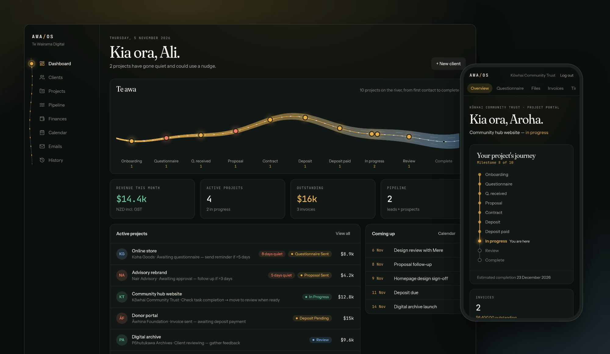

# AWA/OS

**The operating system for a small web studio, with the whole pipeline drawn as a river.**

A full-stack app that runs a studio from first enquiry to final invoice, plus a portal where each client can follow their own project.


[The river](#the-river) · [Tour](#tour) · [Features](#features) · [Architecture](#architecture) · [Engineering notes](#engineering-notes) · [Running it](#running-it-locally)

</div>

## What it is

AWA/OS is two products on one codebase:

- **The studio app** is where the work gets run: clients, projects, the pipeline, invoices, the calendar, email and a full activity history.
- **The client portal** is what each client sees: where their project is up to, a questionnaire to fill in, files to share, and invoices to view and pay.

It's built for [Te Wairama Digital](https://tewairama.digital), a web studio in Aotearoa New Zealand.

> **Status:** a working demo, ahead of the business moving onto it. All the names, projects and figures in these screenshots are fictional.

## The river

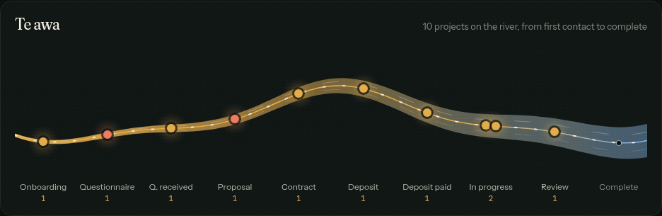

*Awa* is te reo Māori for river. Most CRMs show a pipeline as columns of cards, so this one draws it as water instead.

The river starts as a stream at first contact and widens on its way to completion. **Every bead is a real project sitting at its real stage.** Projects that have gone quiet turn coral, hovering shows the detail, and clicking opens the project.

It's the same river everywhere. Clients see it lit up as far as they've come, with a "You are here" marker. It also runs along the top of the pipeline board, across each project page and behind the login. The sidebar has its own small stream, with a bead of light that follows you between pages.

## Tour

### Studio app

The dashboard answers one question: what needs me today? Your whole pipeline, your numbers, the projects going quiet and what's coming up.

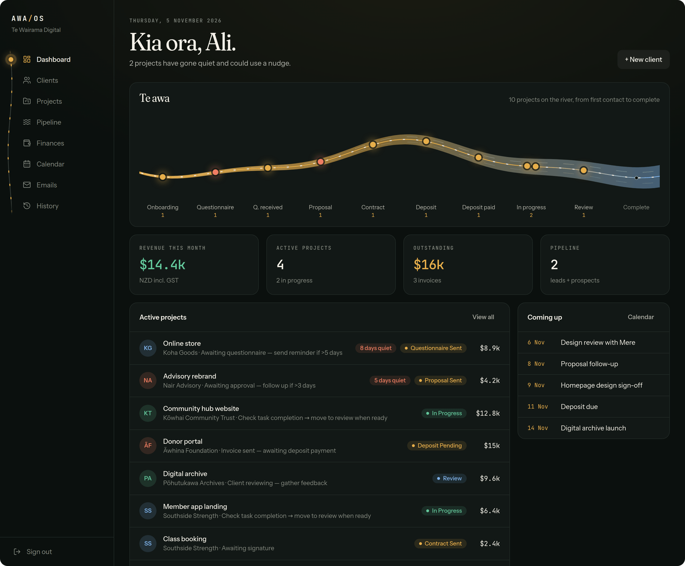

The pipeline board hangs off the river, with each stage's value and count at a glance.

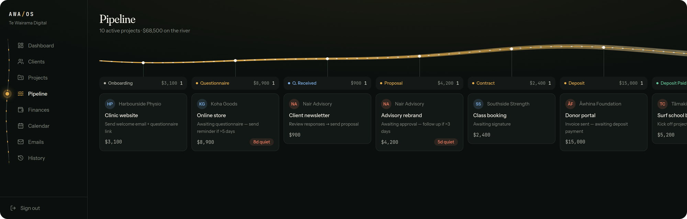

Every project shows where it is, what should happen next, and everything attached to it.

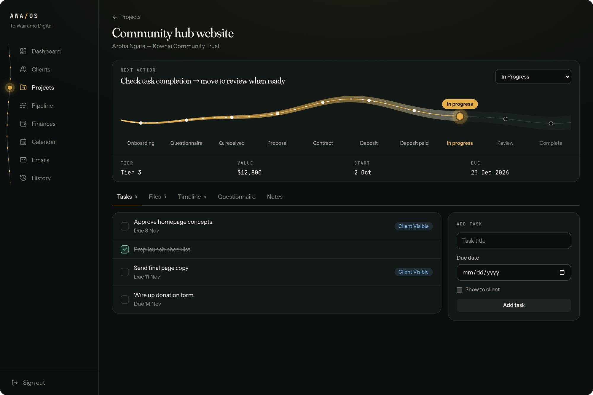

<table>
  <tr>
    <td width="50%">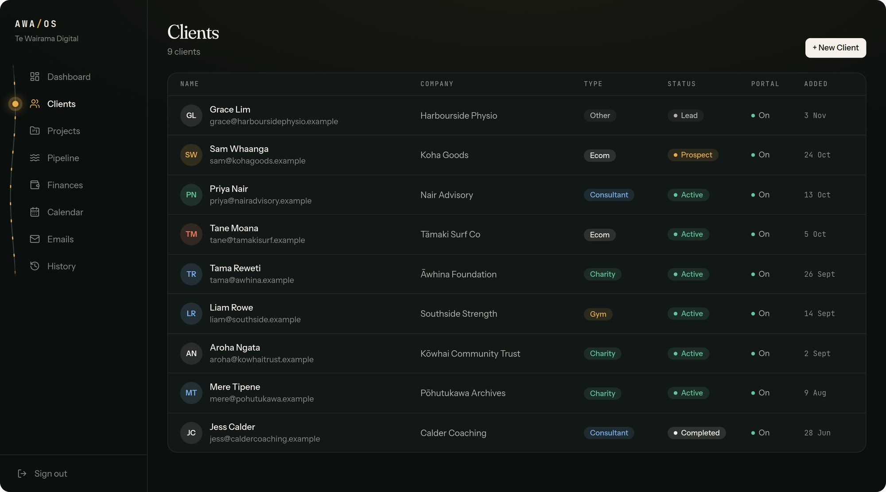</td>
    <td width="50%">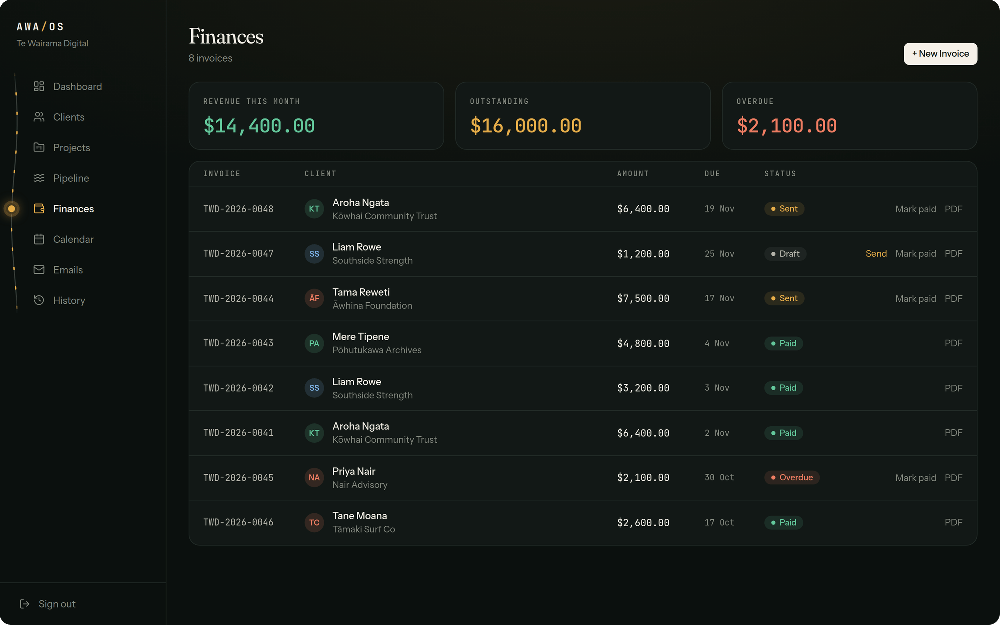</td>
  </tr>
  <tr>
    <td align="center"><sub>Clients</sub></td>
    <td align="center"><sub>Finances</sub></td>
  </tr>
  <tr>
    <td>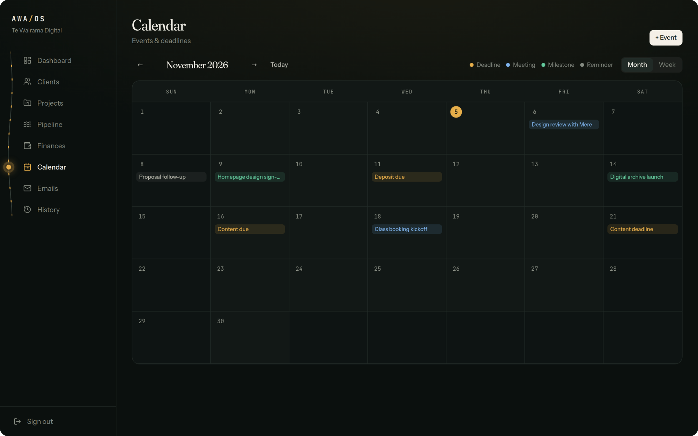</td>
    <td>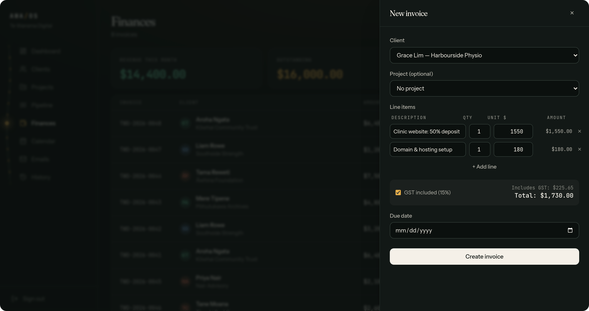</td>
  </tr>
  <tr>
    <td align="center"><sub>Calendar</sub></td>
    <td align="center"><sub>Creating an invoice</sub></td>
  </tr>
  <tr>
    <td>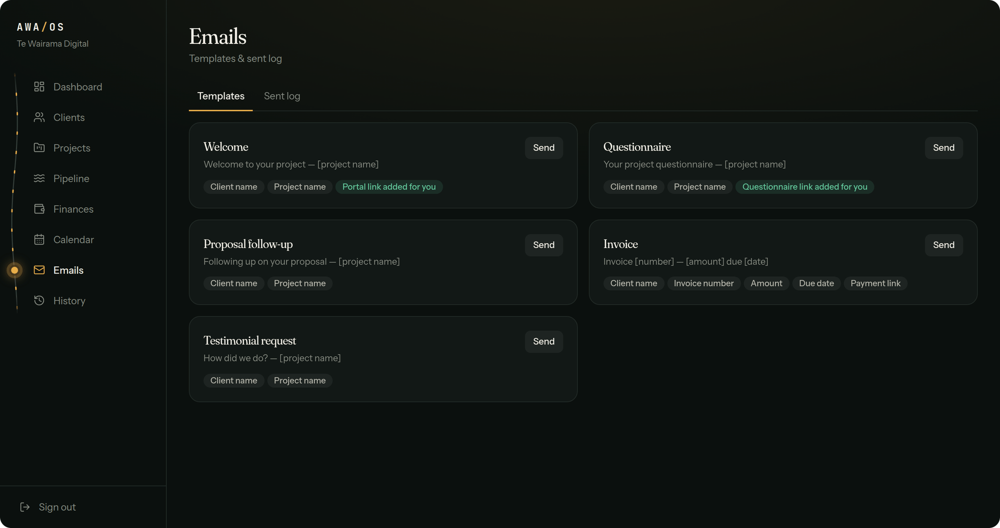</td>
    <td>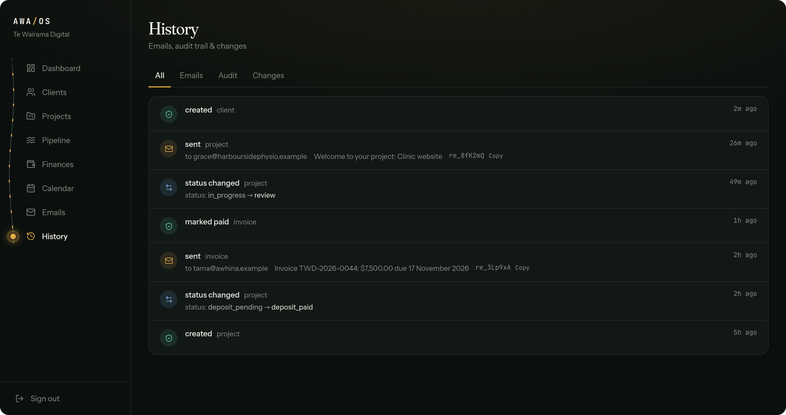</td>
  </tr>
  <tr>
    <td align="center"><sub>Email templates</sub></td>
    <td align="center"><sub>Activity history</sub></td>
  </tr>
  <tr>
    <td>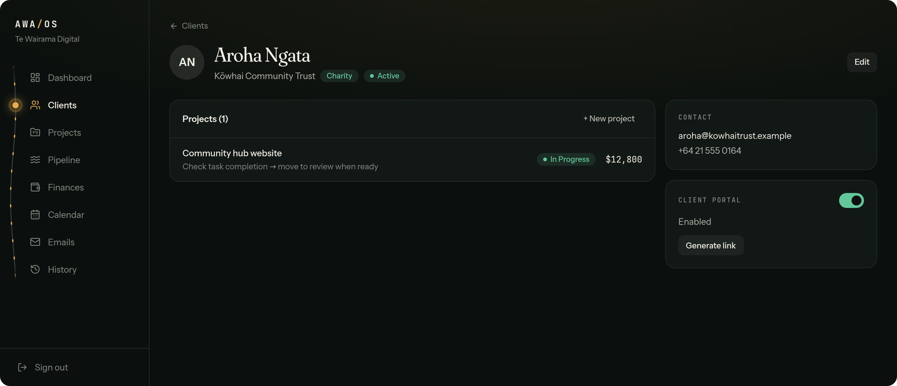</td>
    <td>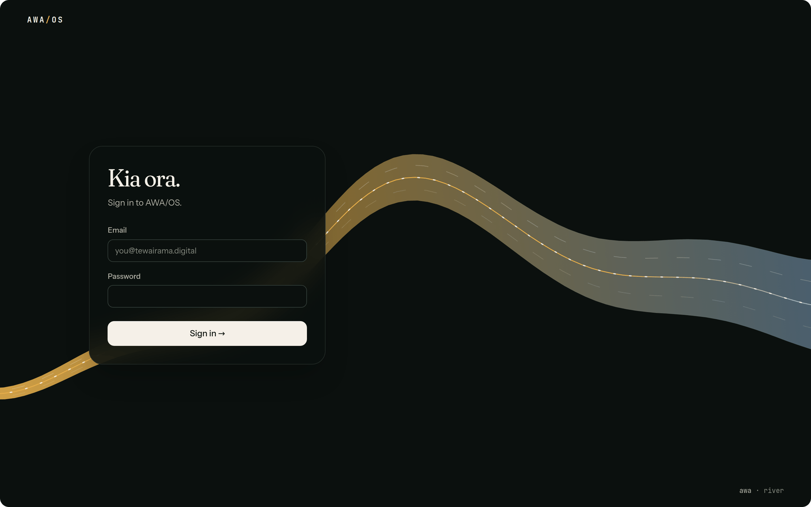</td>
  </tr>
  <tr>
    <td align="center"><sub>Client profile</sub></td>
    <td align="center"><sub>Login</sub></td>
  </tr>
</table>

### Client portal

Clients get one calm place instead of a trail of emails. The first thing they see is exactly where their project is up to.

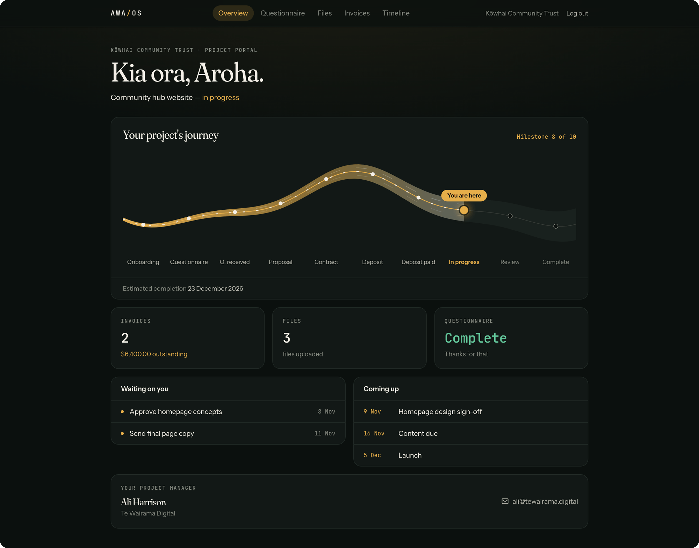

<table>
  <tr>
    <td width="50%">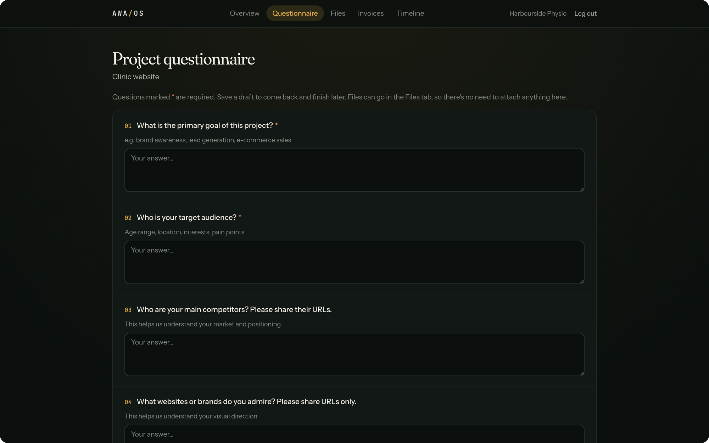</td>
    <td width="50%">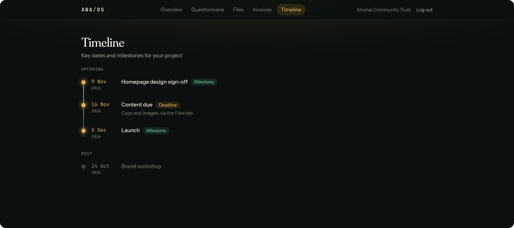</td>
  </tr>
  <tr>
    <td align="center"><sub>Onboarding questionnaire</sub></td>
    <td align="center"><sub>Timeline</sub></td>
  </tr>
  <tr>
    <td>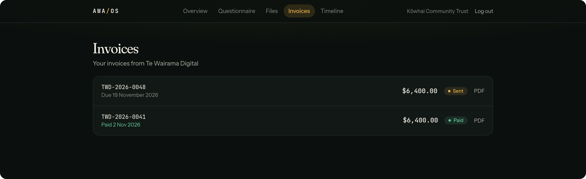</td>
    <td>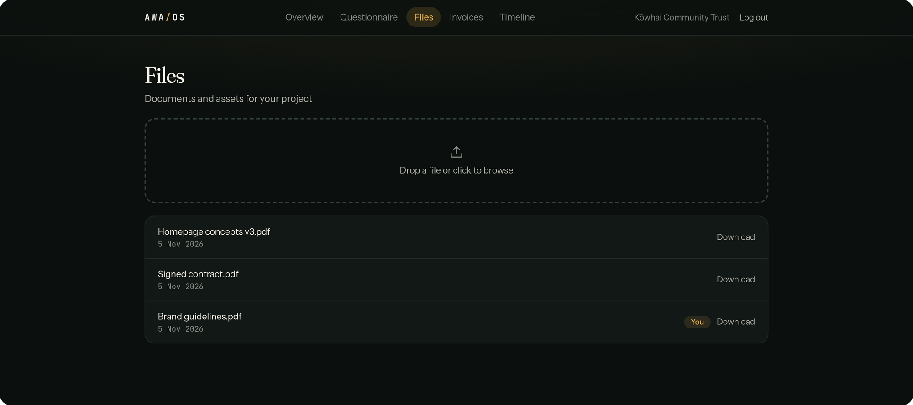</td>
  </tr>
  <tr>
    <td align="center"><sub>Invoices</sub></td>
    <td align="center"><sub>Files</sub></td>
  </tr>
</table>

### On a phone

Everything works at phone width. In the portal, the river turns and runs down the screen.

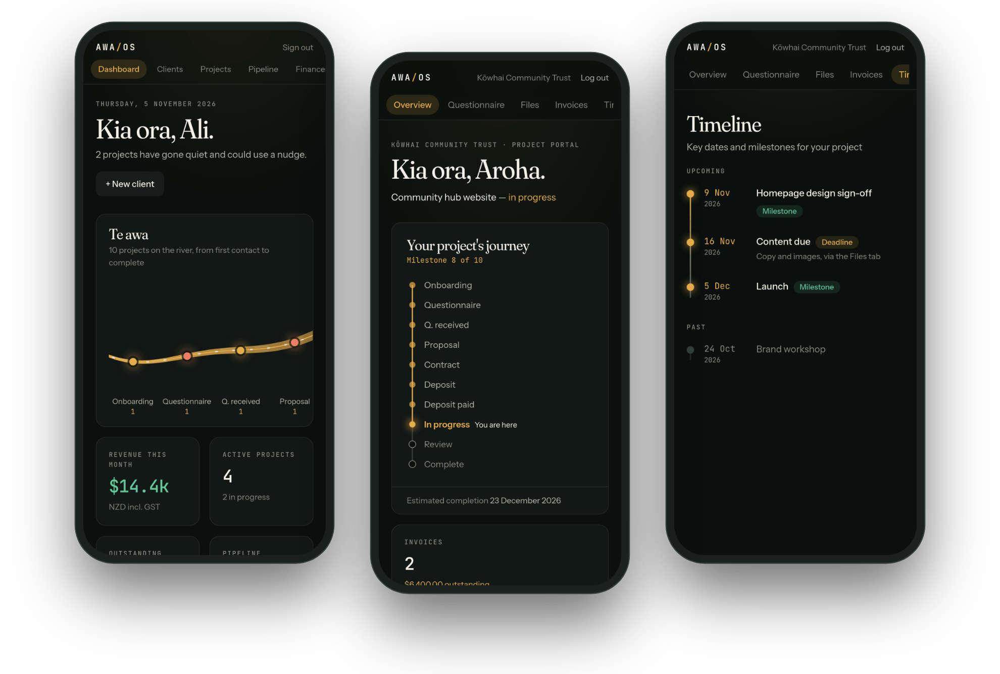

## Features

**Clients and projects**
- A 10-stage pipeline from onboarding to complete, with a suggested next action at every stage
- Quiet projects flagged automatically when a questionnaire or proposal has been waiting too long
- Tasks, files, a timeline and private notes on every project, with per-item control over what clients can see

**Automated onboarding**
- Creating a project sends the client a one-time portal setup link and their questionnaire, then moves the project along
- If an email fails, the project is kept, stays at Onboarding, and you're told what happened

**Invoicing**
- Line items, GST-inclusive totals and sequential numbering (`TWD-2026-0041`)
- Stripe Payment Links, with invoices marked paid automatically by webhook
- Server-rendered PDF invoices, attached when emailed and downloadable from both apps
- Overdue status worked out from the due date

**Client portal**
- Password setup through a one-time link, with access you can revoke instantly
- Questionnaires tailored by client type, with saved drafts
- File upload and download, invoices with online payment, and a project timeline

**Running the business**
- Month and week calendar, with events you can share with clients
- Five email templates with a sent log, plus a filterable history of emails, audit events and status changes

## Tech stack

| Layer | Choice |
| --- | --- |
| Framework | Next.js 16 (App Router, Server Components, Server Actions), React 19, TypeScript |
| Styling | Tailwind CSS 4 with design tokens, hand-built SVG for the river |
| Database | Supabase Postgres with row level security, 10 tables, versioned SQL migrations |
| Auth | Supabase Auth for staff, a custom signed session for clients |
| Storage | Supabase Storage, in a private bucket with signed URLs |
| Payments | Stripe Payment Links and webhooks |
| Email | Resend, with table-based HTML templates |
| PDFs | `@react-pdf/renderer`, rendered on the server |
| Hosting | Vercel |

## Architecture

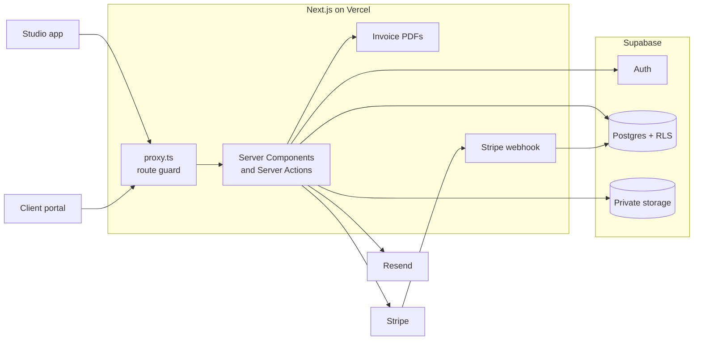

The two audiences reach the database differently. Staff requests run as the logged-in user, so Postgres row level security applies. Clients have no Supabase account, so portal code uses the service role and is responsible for its own checks, which is why those checks sit at every entry point.

### Data model

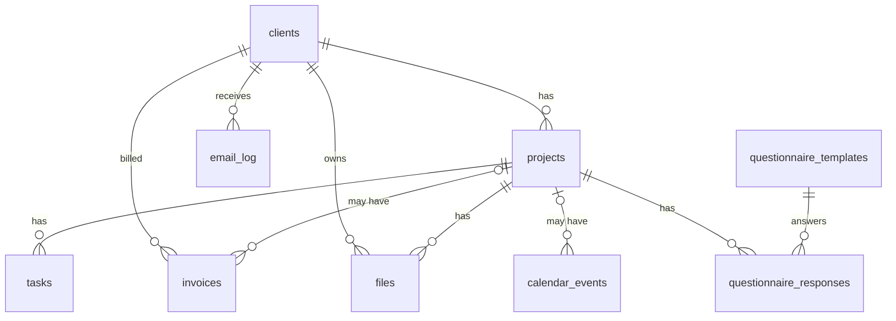

There's also an append-only `activity_log`, which powers the history page.

## Engineering notes

The parts I found most interesting to get right.

### Two kinds of user, two auth models

Staff use Supabase Auth. Clients don't have Supabase accounts, so the portal has its own flow: a one-time token, a password hashed with scrypt, then an HMAC-signed, expiring cookie.

```ts
/** Serialise a session as `payload.signature`, so the browser can't edit it. */
export function encodePortalSession(session: PortalSession): string {
  const exp = Math.floor(Date.now() / 1000) + PORTAL_COOKIE_MAX_AGE
  const payload = Buffer.from(JSON.stringify({ ...session, exp })).toString('base64url')
  return `${payload}.${sign(payload).toString('base64url')}`
}
```

A valid signature isn't the whole check. `requirePortalClient()` looks up the client's `portal_access` on every request, so revoking access takes effect straight away rather than when the cookie expires. See [`src/lib/portal`](src/lib/portal).

### Checking auth at every door

Server Actions are public POST endpoints, so guarding the page an action sits on doesn't protect the action. `src/proxy.ts` gates URLs, then every action makes its own check with `requireUser()` or `requirePortalClient()`. Staff queries also run under RLS, so the database enforces access as well.

### Uploads for people with no login

Clients can't write to a private bucket directly. Instead, the server checks their session and hands back a signed URL for one file, and the browser uploads straight to storage, so large files never pass through a serverless function. The server then checks the path belongs to that client before recording it. Storage rejects macrons in file names, so object keys are sanitised while the original name is kept for display.

### Money

Invoice amounts are integer cents everywhere. The form works in dollars and converts in one place, and the server recalculates totals from the line items instead of trusting the browser.

Paying an invoice crosses three systems. The invoice number goes into the Stripe Payment Link's metadata, Stripe copies that onto the Checkout Session, and the webhook uses it to find the invoice. The webhook verifies Stripe's signature, its update is safe to replay, and a failed write returns a 500 so that Stripe retries.

### Time zones

A `datetime-local` input has no time zone, so it's converted to UTC in the browser, where "local" means the user's own clock. Displayed dates are pinned to `Pacific/Auckland`, because a server in UTC is on a different calendar day to New Zealand for half of every day. Without that, server and browser render different text and hydration breaks. See [`src/lib/format.ts`](src/lib/format.ts).

### Drawing the river

The river is one set of pure functions in [`geometry.ts`](src/components/river/geometry.ts), which keeps every instance in step.

- The SVG stretches to fill any box with `preserveAspectRatio="none"`, and `vector-effect: non-scaling-stroke` stops its lines distorting.
- Beads are plain HTML placed by percentage from the same maths, so they stay round and work as real links with keyboard focus.
- Coordinates are rounded so server and browser print identical strings.
- The flow is a moving `stroke-dasharray`, and it stops for anyone with reduced motion turned on.

### Design system

Colours, type and motion are tokens in [`globals.css`](src/app/globals.css), with no hard-coded colours in the UI. Fraunces handles the human moments, Instrument Sans the reading, and JetBrains Mono the labels and figures. All three load with `latin-ext`, because te reo Māori needs its macrons.

## Project structure

```text
src/
├── app/
│   ├── (auth)/login/             Staff login
│   ├── (internal)/               The studio app
│   │   ├── dashboard/  clients/  projects/  pipeline/
│   │   └── finances/   calendar/ emails/    admin/history/
│   ├── portal/
│   │   ├── [clientSlug]/
│   │   │   ├── (portal)/         Logged-in client pages
│   │   │   └── setup/            One-time password setup
│   │   └── access/ login/ logout/ expired/
│   └── api/webhooks/stripe/      Payment webhook
├── components/
│   ├── river/                    The river: geometry, map, journey
│   ├── brand/  layout/  pdf/
│   └── ui/                       Buttons, cards, inputs, badges
├── lib/
│   ├── portal/                   Client sessions and auth
│   ├── supabase/  resend/  stripe/
│   └── format.ts  invoices.ts  storage.ts
├── proxy.ts                      Route guard
└── types.ts
supabase/migrations/              Schema, RLS policies, storage, seeds
```

## Running it locally

You'll need Node 20.9 or newer and a [Supabase](https://supabase.com) project. Resend and Stripe are only needed for email and payments.

```bash
git clone https://github.com/ali-harrison/Awa-OS.git
cd Awa-OS
npm install
cp .env.example .env.local
```

Fill in `.env.local`, then apply the migrations:

```bash
supabase link --project-ref your-project-ref
supabase db push
```

In the Supabase dashboard, add yourself under **Authentication → Users** and turn off public sign-ups, because every Supabase user counts as staff. Then start the app:

```bash
npm run dev
```

Open [localhost:3000](http://localhost:3000). In dev mode, portal pages also render without logging in, at `/portal/<client-slug>`, which makes previewing easy. This never applies in production.

### Environment variables

| Variable | Needed for |
| --- | --- |
| `NEXT_PUBLIC_SUPABASE_URL` | Everything |
| `NEXT_PUBLIC_SUPABASE_ANON_KEY` | Everything. Must be the public key, as it reaches the browser |
| `SUPABASE_SERVICE_ROLE_KEY` | The portal, server side only |
| `PORTAL_SESSION_SECRET` | Signing portal cookies. Optional, falls back to the service role key |
| `RESEND_API_KEY` | Sending email |
| `STRIPE_SECRET_KEY` | Payment links. Optional, invoices work without them |
| `STRIPE_WEBHOOK_SECRET` | Marking invoices paid automatically |
| `NEXT_PUBLIC_BANK_ACCOUNT` | Bank details on invoices |
| `NEXT_PUBLIC_WHATSAPP_NUMBER` | Portal WhatsApp link. Optional, hidden if blank |

### Stripe webhook

Point a webhook at `/api/webhooks/stripe` and subscribe to `checkout.session.completed` and `checkout.session.async_payment_succeeded`.

### Scripts

| Command | What it does |
| --- | --- |
| `npm run dev` | Start the dev server |
| `npm run build` | Production build |
| `npm run start` | Serve the production build |
| `npm run lint` | ESLint |

## What's next

- **Automated tests.** Flows have been checked with throwaway end-to-end scripts so far. These should become a proper suite that runs in CI.
- **Rate limiting** on portal login.
- **Single-use payment links**, so a paid invoice's link can't be paid twice.
- **A shareable demo** on seeded fictional data.

---

<div align="center">
<sub>Built by <a href="https://github.com/ali-harrison">Ali Harrison</a> · <a href="https://tewairama.digital">Te Wairama Digital</a> · Aotearoa New Zealand</sub>
</div>
