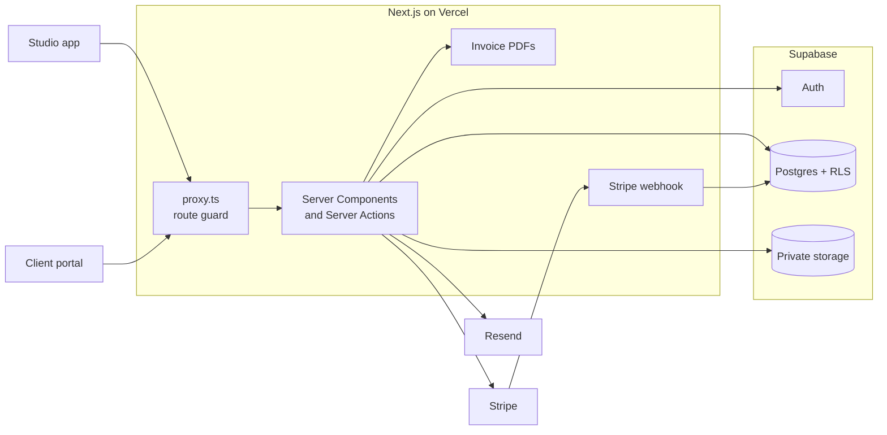

# AWA/OS

A studio app that runs a web project from first enquiry to final invoice, with a portal where each client can follow their own project. The whole pipeline is drawn as a river.

Designed and built by me, Ali Werahiko Te Wairama Harrison, for my studio [Te Wairama Digital](https://tewairama.digital), with Next.js 16, React 19, TypeScript, Supabase, Stripe, Resend and Tailwind CSS 4.

It's a working build that the business hasn't moved onto yet, and there's no public demo, so these screenshots are the way to see it. All the names and figures in them are fictional.

## The river


Awa is te reo Māori for river. Most CRMs show a pipeline as columns of cards, so I drew it as water instead. It starts as a stream at first contact and widens towards completion. Every bead is a real project at its real stage, projects that have gone quiet turn coral, and clicking a bead opens the project.

Clients see the same river lit up as far as they've come, with a "You are here" marker.

## The studio app

The dashboard shows what needs me today: the pipeline, the numbers, the projects going quiet and what's coming up.


The pipeline board hangs off the river, with each stage's value and count, and every project page shows what should happen next.


Creating a project emails the client a one-time portal link and their questionnaire, then moves the project along. If the email fails, the project stays at Onboarding and the app says what happened.

Invoices have line items, GST-inclusive totals and sequential numbers. They go out as server-rendered PDFs with Stripe Payment Links, and a webhook marks them paid.

<table>
  <tr>
    <td width="50%"></td>
    <td width="50%"></td>
  </tr>
  <tr>
    <td></td>
    <td></td>
  </tr>
</table>

## The client portal

Clients get one place instead of a trail of emails. They can see where their project is up to, fill in their questionnaire, share files and pay invoices.


<table>
  <tr>
    <td width="50%"></td>
    <td width="50%"></td>
  </tr>
  <tr>
    <td></td>
    <td></td>
  </tr>
</table>

Everything works at phone width. In the portal, the river turns and runs down the screen.


## How it's built



### Two kinds of user

Staff use Supabase Auth, so their requests run under row level security. Clients don't have Supabase accounts, so the portal has its own flow: a one-time token, a password hashed with scrypt, then an HMAC-signed cookie that expires.

```ts
/** Serialise a session as `payload.signature`, so the browser can't edit it. */
export function encodePortalSession(session: PortalSession): string {
  const exp = Math.floor(Date.now() / 1000) + PORTAL_COOKIE_MAX_AGE
  const payload = Buffer.from(JSON.stringify({ ...session, exp })).toString('base64url')
  return `${payload}.${sign(payload).toString('base64url')}`
}
```

`requirePortalClient()` also looks up the client's `portal_access` on every request, so revoking access works straight away instead of when the cookie expires. See [`src/lib/portal`](src/lib/portal).

### Checking auth at every door

Server Actions are public POST endpoints, so guarding the page an action sits on doesn't protect the action. `src/proxy.ts` gates the URLs, and every action makes its own check with `requireUser()` or `requirePortalClient()`.

### File uploads

Clients can't write to a private bucket directly. The server checks their session and hands back a signed URL for one file, and the browser uploads straight to storage, so large files never pass through a serverless function. Storage rejects macrons in file names, so object keys are sanitised and the original name is kept for display.

### Money

Invoice amounts are integer cents everywhere, and the server recalculates totals from the line items instead of trusting the browser. The invoice number travels through Stripe's metadata so the webhook can find the invoice. The webhook verifies Stripe's signature, is safe to replay, and returns a 500 on a failed write so Stripe retries.

### Time zones

Displayed dates are pinned to `Pacific/Auckland`, because a server in UTC is on a different calendar day to New Zealand for half of every day, and server and browser would otherwise render different text. See [`src/lib/format.ts`](src/lib/format.ts).

### The river

The river is one set of pure functions in [`geometry.ts`](src/components/river/geometry.ts), which keeps every copy of it in step. The SVG stretches to fill any box, `vector-effect: non-scaling-stroke` stops its lines distorting, and the beads are plain HTML placed from the same maths, so they stay round and work as real links with keyboard focus. The flow is a moving `stroke-dasharray` that stops for anyone with reduced motion turned on.

## Running it

You'll need Node 20.9 or newer and a [Supabase](https://supabase.com) project. Resend and Stripe are only needed for email and payments.

```bash
git clone https://github.com/ali-harrison/Awa-OS.git
cd Awa-OS
npm install
cp .env.example .env.local
```

Fill in `.env.local`, which explains each variable, then apply the migrations and start it:

```bash
supabase link --project-ref your-project-ref
supabase db push
npm run dev
```

Add yourself under Authentication → Users in the Supabase dashboard and turn off public sign-ups, because every Supabase user counts as staff. For payments, point a Stripe webhook at `/api/webhooks/stripe` and subscribe to `checkout.session.completed` and `checkout.session.async_payment_succeeded`.

## What's next

- An automated test suite in CI, to replace the throwaway end-to-end scripts I've used so far
- Rate limiting on portal login
- Single-use payment links, so a paid invoice's link can't be paid twice
- A shareable demo on fictional data
